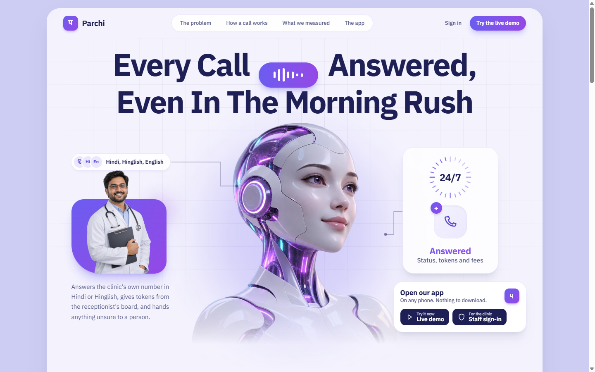
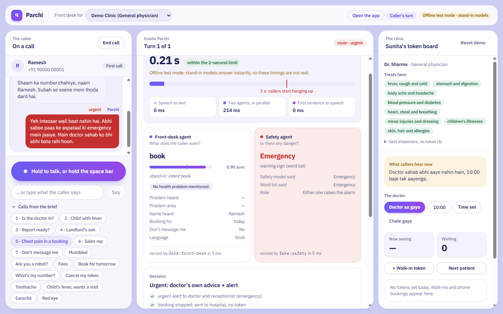
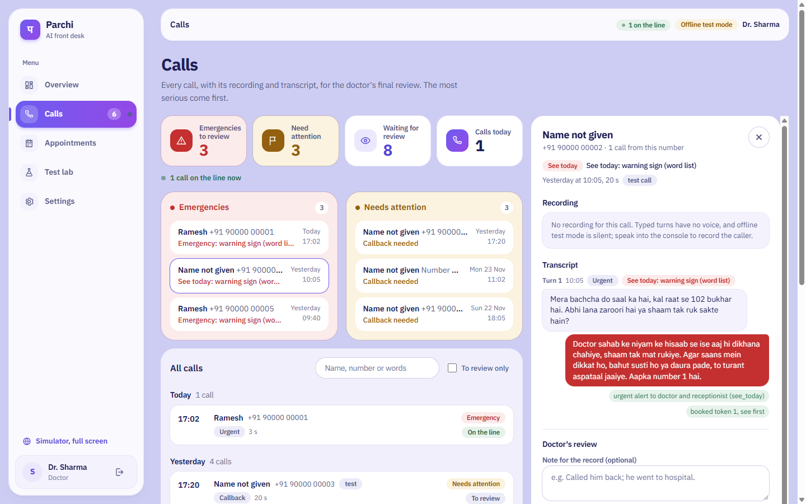

# Parchi: an AI front desk for small clinics

A working slice of **Parchi**, an AI front desk for one- to three-doctor clinics in tier-2 Indian cities. It answers the clinic's calls in Hindi and Hinglish, gives tokens from the receptionist's board, and sends danger to a hospital in the doctor's own words.

This repository is deliverable 7 of a take-home assessment: decide what v1 is, design it, and build the riskiest piece. The written deliverables (decision memo, call scripts, architecture, AI design and policy, cost sheet, AI-use log) were submitted separately. The clinic, doctor and patients in the demo are made up.



## The riskiest piece

Software must handle most calls from callers who say anything, in Hindi or Hinglish, and who hang up after 2 seconds of silence. So the slice is the live call: speech in, two LangGraph agents, speech out.

- **Two agents read every sentence in parallel.** A front-desk agent works out what the caller wants; a safety agent listens only for danger, so checking adds no wait. A plain word list (Roman, Devanagari and Urdu script) backs it up.
- **Facts come from data, never the model.** The doctor's status and every token number come from the receptionist's board; whether this doctor treats a problem comes from the clinic's file.
- **Every AI job has an ordered list of models across providers.** If one fails or runs out of time, the next answers, and the screen shows which model served each step.
- **It works, and it fails on speed.** Answers start 2.1 to 3.9 seconds after the caller stops, against a 2-second limit. That is shown on screen, not hidden.



*The simulator during call 5: chest pain mentioned inside a booking. Emergency: hospital now, no token, the doctor alerted. (Offline test mode, so the timing shown is not real.)*



*The staff app: every call with its transcript and recording, emergencies first, for the doctor's review.*

## Run it

Python 3.12 and Node 20 or later. No API key is needed in offline test mode.

```
cd working-slice
pip install -r requirements.txt
copy .env.example .env               set PARCHI_FAKE_MODELS=1 for offline mode, or add an OpenAI key
cd web && npm install && npm run build && cd ..
python -m parchi.server              then open http://127.0.0.1:8765
```

On Windows, `working-slice\run.bat offline` does all of this and opens the browser. The intro page is at `/`, the call simulator at `/demo/`, and the staff app at `/app/` (test sign-ins: `doctor-test`, `reception-test`).

**[A five-minute walkthrough](working-slice/DEMO.md)** shows why this piece, it working, and it failing, step by step.

## Tests

From `working-slice/`:

```
python -m unittest                   167 tests, offline
cd web && npm run test:e2e           44 browser tests, offline (builds the UI first)
python evaluate_agents.py            74 caller lines through the real agents (needs a key; logs in evaluation/logs/)
```

How it works, how each clinic is configured as data, the staff app, security, model routing, what was measured and what is not shown: [working-slice/README.md](working-slice/README.md).
