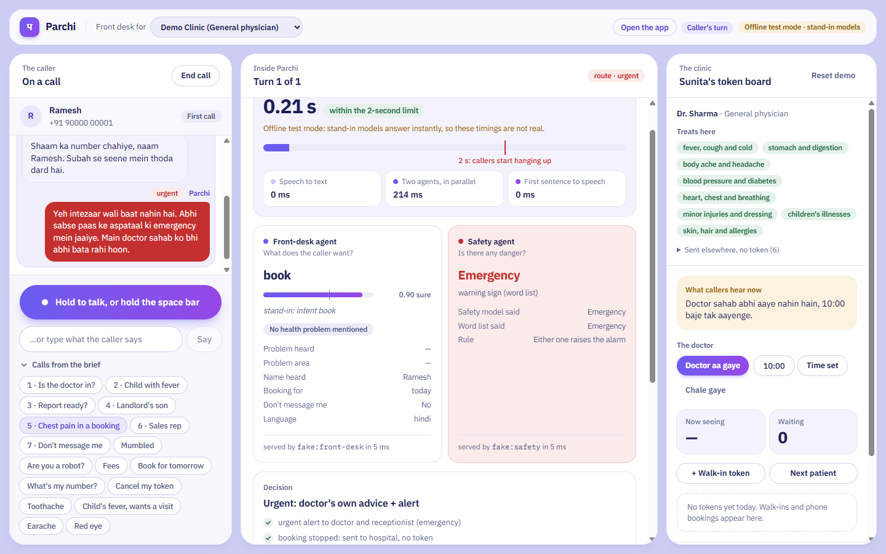

# Parchi working slice: a caller says anything

Deliverable 7. A live voice demo: you speak as a patient, Parchi answers aloud, and the screen shows what it decided, why, and how long it took.

**Why this piece is the riskiest.** Software must handle most calls from callers who say anything, in Hindi and Hinglish, and who hang up after 2 seconds of silence. Two things can sink v1:
- understanding them correctly, especially danger such as chest pain mentioned in passing;
- answering fast enough.



More screenshots: [the intro page](screenshots/landing.png), [the staff app's call log](screenshots/staff-calls.png).

## Quick start

Needs Python 3.12 and Node 20 or later.

**On Windows, one step:** double-click `run.bat` (or run it from a terminal). It installs what is missing, creates `.env` in offline test mode if there is none, builds the UI once, starts the server and opens the browser. `run.bat live` uses real models, `run.bat build` rebuilds the UI, `run.bat test` runs every offline check, and `run.bat help` lists them all. By hand:

```
cd working-slice
pip install -r requirements.txt
copy .env.example .env               then put your OpenAI key in .env
cd web && npm install && npm run build && cd ..
python -m parchi.server               open http://127.0.0.1:8765 (intro page; the console is at /demo/,
                                     the staff app at /app/)
```

- **No key?** Set `PARCHI_FAKE_MODELS=1` in `.env` to run in **offline test mode**: stand-in models, no cost, the same answers every time.
- **To speak:** click **Start a call**, then hold the button (or the space bar) and talk.
- **To skip speaking:** type the caller's words, or click one of the brief's calls.

## How a turn works

```
caller speaks
   │  speech to text            Deepgram nova-3 → OpenAI (fallback)
   ▼
 ┌──────────── LangGraph ─────────────────────────────────────────────┐
 │  front-desk agent ─┐                                                │
 │                    ├─► decide ─► status | book | my_booking |     │
 │  safety agent ─────┘           cancel | info | medical | not_here | │
 │  (in parallel)                 urgent | about | clarify | handoff   │
 └────────────────────────────────────────────────────────────────────┘
   │  text to speech            OpenAI (fixed sentences made once and replayed)
   ▼
caller hears the answer
```

- **Two agents run in parallel.** The front-desk agent works out what the caller wants; the safety agent only listens for danger. Running together, safety adds no wait.
- **Safety always wins.** A word list (Roman and Devanagari) sits beside the safety agent, and either can raise the alarm. Urgent replies use the doctor's own signed sentences.
- **Facts come from the clinic's data**, never the model, so it cannot invent the doctor's time or a token number.
- **Every token number and day comes from the appointment book**, never the model. See *Appointments* below.
- **No false hope.** The front-desk agent names the caller's problem area; whether this doctor treats it comes from the clinic's file. If not, the caller gets no token, is told who to see, and is told to go to a hospital if it gets worse (`not_here`). See *Each clinic, as data* below.
- **Unsure means** one either-or question, then a person. LangGraph's checkpointer remembers each call.
- **It degrades, never breaks.** If every front-desk model fails, the caller goes to a person. If the safety models fail, the word list still runs.

## Each clinic, as data

Nothing about a clinic is in the code. One server answers for one clinic, named by `PARCHI_CLINIC`.

| File | What it holds |
| --- | --- |
| `clinics/<id>.toml` | One clinic: name, fees, timings, address, the receptionist, the doctor, **what the doctor treats**, and the doctor's own "see today" rule. Demo clinics: `general-physician`, `dental`, `ent` |
| `clinics/problem-areas.toml` | The 14 kinds of problem a caller may mention, how to recognise each, and who to send the caller to when this doctor does not treat it |
| `clinics/emergency.toml` | Signs that mean "go to hospital now", the same at every clinic |
| `parchi/prompts/front_desk.md`, `safety.md` | The two agents' instructions, filled in from the clinic's file |
| `parchi/prompts/replies.toml` | Every sentence Parchi speaks, each with an English gloss |

Every file is checked when it loads. A clinic that treats an unknown problem area, or a sentence with an unfilled gap, stops the server at start-up with a clear message, rather than reaching a caller.

**How a health problem is routed.**

1. **An emergency wins at every clinic.** "Go to hospital now", the doctor alerted, and no token, even when it is mentioned inside a booking (call 5), so nothing suggests the caller can wait. Chest pain at a dentist's is still an emergency.
2. **The doctor's "see today" rule applies only to what the doctor treats.** A child's fever is "see today" at the general physician's and "not treated here" at the dentist's.
3. **Not treated here:** no token, who to see instead, and the safety net (`not_here`).
4. **A problem that fits no area** goes to the doctor as a question, with no token and no promise.

The model only names the problem area. The decision is made in code (`call_graph.scope_of`), so the model cannot promise a visit the doctor would not give. In demo and test mode the console has a switcher to try each clinic; production refuses it.

## Appointments

Every token is an appointment in `PARCHI_DATA_DIR/appointments.sqlite`: one clinic, one day, a number from 1 each day, the patient's name, the caller's phone number for phone bookings, and a status: *waiting*, *with the doctor*, *seen* or *cancelled*. The doctor's status on the board is kept per day too, so a restart loses nothing and each day starts fresh at midnight (clinic time).

| A caller says | What happens |
| --- | --- |
| "Number chahiye" | A token for today. After the doctor has left, or on a day the clinic is closed, it is for the next open day, and the caller hears which ("kal ke liye", "somvaar ke liye") |
| "Kal subah ka number" | A token for tomorrow, or the next open day after it. "Kal se bukhar hai" (since yesterday) is not a booking day |
| "Number chahiye" again, from the same number | No second token for the same person on the same day: they hear the one they have. A different name (someone else in the family) gets their own |
| "Mera number kya tha?" | Read from the book: their number and how many are ahead, or when to come. A withheld number goes to the receptionist |
| "Nahin aa paunga, cancel kar dijiye" | Their waiting token is cancelled and the board shows it. Two family tokens and no name: the receptionist asks which |

The front-desk agent is told this caller's bookings and says what the caller wants (`my_booking`, `cancel`, or `book` with `booking_day`). The call graph reads and changes the book, so a model never states a token number. On the board, the receptionist cancels a token with one tap. **Next patient** takes *see first* patients before others, then goes in number order and skips cancelled tokens. Bookings for later days are listed under the day's queue. The days a clinic is closed are in its file (`closed_days`), and the doctor can change them in Clinic settings. Appointments are deleted after `PARCHI_RETENTION_DAYS`, like the call log. Resetting the board, which clears the book, is refused in production.

**Known limits.** One queue per day, not separate morning and evening sessions; one doctor per clinic; no reminder messages yet (the WhatsApp confirmation is recorded as an action, not sent).

## The staff app

One signed-in app for the doctor and the receptionist, at <http://127.0.0.1:8765/app/> (the old `/dashboard/` address leads to it). A sidebar, a drawer on a phone, and five pages:

| Page | What it is for |
| --- | --- |
| **Overview** | Today at a glance: emergencies and calls needing attention (each opens that call), the board, the latest calls |
| **Calls** | Every call by day, with recording, transcript and the doctor's review; listen to a live call or take it over |
| **Appointments** | The receptionist's token board: the doctor's status (what callers hear), today's queue, later bookings, what reached the doctor |
| **Test lab** | **Run all checks** (below), test data, and the call simulator, where you play the caller |
| **Settings** | Clinic (the doctor edits it), Access and security, and System (what the server runs with) |

**Run all checks** plays the brief's calls (calls 1 to 7, "are you a robot?", fees, unsure twice, "my token?", cancel) through the real call flow, on a fresh, in-memory board for the general physician's clinic with the doctor's saved settings, and shows each one passed or failed, with every line said and answered. Nothing real is touched. Offline it is free and the same every time; with live models it is a real evaluation, costs a few cents, and asks first.

**Access and security** and **System** are read-only on purpose: they are set in `.env` and checked when the server starts, so a browser can never weaken them. Keys and password hashes are never shown, only whether they are set.

Every call is kept, with the caller's number and name, the transcript, what Parchi did and the recording, for the doctor's final review.

- **Who called.** Each caller is identified by their number. The first name heard from a number is remembered, so a returning caller is recognised, and a phone booking's token carries the number. A different name on a known number (a family phone) shows both.
- **What needs the doctor first.** *Emergencies* (an emergency sign, or a child to be seen today) and *Needs attention* (a question for the doctor, or a callback), until reviewed.
- **Every call, by day.** Today, Yesterday and earlier, searchable by name, number or words said.
- **Each call.** The recording (the caller's voice and Parchi's replies, played in order), the transcript turn by turn, the doctor's review with a note, and who has opened it.
- **Live calls.** A call still on the line can be heard as it happens (**Listen live**). **Take over the call** and Parchi tells the caller who is joining ("Ek minute, main aapki baat doctor sahab se karwa rahi hoon"), then steps back: the caller's words go to that person, who answers by holding to speak (their own voice is relayed) or by typing (spoken in Parchi's voice). The word list still marks danger. **Hand back to Parchi** and it answers again. All of it, with who said what, goes into the transcript and the recording.
- **Clinic settings.** The doctor changes the clinic's details (name, fees, timings, address, start time, receptionist), their own name and speciality, **what they treat** (a checklist of the 14 problem areas, each showing who callers are sent to when it is not ticked), and their "see today" rule (signs, alarm words, and the sentence Parchi says). Each save is checked like a clinic file and takes effect from the caller's next sentence. A call under way keeps its memory, and the token board is kept. A change to the "see today" rule is signed with the doctor's name and the date. Every change is in a history, and **Restore the original** returns to the clinic file. Saved changes live in `PARCHI_DATA_DIR/clinic-settings/`; the clinic file is never edited. The emergency rule is shared by every clinic and is shown but not changed here.
- **Roles.** The doctor and the receptionist can both read, listen and take over; only the doctor marks a call reviewed and changes the clinic settings.

**Signing in.** Passwords are stored only as hashes: make one with `python -m parchi.auth hash` and put it in `.env` as `PARCHI_DOCTOR_PASSWORD_HASH` (and `PARCHI_RECEPTION_PASSWORD_HASH`). In offline test mode, or with `PARCHI_DEMO_LOGINS=1`, the test sign-ins are `doctor-test` and `reception-test`. Production refuses them.

**Test mode.** With `PARCHI_FAKE_MODELS=1` everything runs with no key. Make calls in the console (pick a test number; call twice from one to see it recognised), then click **Add test calls** on the dashboard to fill earlier days with the brief's calls, run through the real call graph and marked as test calls. Offline mode is silent, so recordings hold only what you say into the microphone.

**Security.**

| Protection | How |
| --- | --- |
| Sign-in | PBKDF2-SHA256 password hashes (600,000 iterations). After 5 wrong passwords from one address in 10 minutes, it must wait |
| Sessions | A random token in an HttpOnly, SameSite=Strict cookie (Secure in production). The server keeps only its hash, so signing out ends it. 12 hours |
| Who may do what | Every staff endpoint needs a session; reviewing and changing the clinic settings need the doctor. Every sign-in, opened call, review and settings change is audited |
| Appointments | Names and numbers are personal data: deleted after `PARCHI_RETENTION_DAYS` with the call log. A caller can read or cancel only the bookings made from their own number; a withheld number goes to a person. Production refuses to reset the board |
| Clinic settings | Every field has a length limit and is checked like a clinic file (known problem areas only, at least one treated, a valid time, at least one alarm word); unknown fields are refused. Written atomically, so a crash never leaves half a file |
| Requests from other sites | Refused for anything that changes data (an Origin check, on top of SameSite) |
| Uploads | Audio types only (WebM, Ogg, MP3, WAV, MP4), at most 5 MB. Call ids are 64 random bits and must exist |
| Recordings | Served only to signed-in staff, by id, from paths the server stored itself. Deleted with their calls after 90 days |
| Live calls | Listening and taking over need a session; only the person holding a call can speak on it, and one person at a time. Each is audited |
| Every response | Content-Security-Policy, nosniff, no framing, no referrer. API answers are never cached; HSTS in production |
| Production start-up | Refuses offline test mode, test sign-ins, a missing doctor's password hash, or a weak hash |

**Known limits.** Sessions and live-call streams live in one server's memory: a restart signs everyone out, and several servers would need a shared store. Live audio moves a turn at a time (hold to speak, let go to send), not as a continuous phone stream; a real line would carry both voices continuously. The call log is SQLite, enough for one clinic. The caller's side of the API is open, as a phone line's webhook would be; a real line would sign its requests. The token board's API (`/api/clinic`) is open too, because the simulator plays the receptionist without signing in, and it shows patients' names and numbers: in the product it sits behind her sign-in. Recording patients' calls raises a consent question under India's data protection law (the DPDP Act, 2023), and callers are told about the recording only when they ask: a question for the founder.

## Model orchestration

Each AI job lists its models in order, from any provider. The first model whose provider key is set answers. If it fails or passes the job's time limit, the next one answers, and the screen shows which model served each step.

| Job | Models, in order | Time limit |
| --- | --- | --- |
| Speech to text | `deepgram:nova-3` → `openai:gpt-4o-mini-transcribe` | 5 s |
| Front-desk agent | `openai:gpt-5.4-mini` → `anthropic:claude-haiku-5-5` → `openai:gpt-4.1-mini` | 5 s |
| Safety agent | `openai:gpt-4.1-mini` → `anthropic:claude-haiku-5-5` → `openai:gpt-5.4-mini` | 5 s |
| Text to speech | `openai:gpt-4o-mini-tts` | 8 s |

Change any row in `.env` (`PARCHI_MODELS_*`, `PARCHI_TIMEOUT_*`) without touching code.

## Configuration

All settings live in one typed, validated class: `parchi/settings.py`. Values come from real environment variables first, then `.env`, then the defaults.

| Command or rule | What it gives you |
| --- | --- |
| `python -m parchi.settings` | The effective settings, with keys masked, or a clear list of what is wrong |
| The server checks settings at start-up | It refuses to start if they are wrong: no key for a job, a malformed model name, or offline test mode in production |
| Keys are secrets | They never appear in logs, error messages or the API |
| `PARCHI_ENV` | `development`, `test` or `production` |

Every variable is documented in [.env.example](.env.example). The UI's own variable, for development only, is in [web/.env.example](web/.env.example).

## Test it

| Command | What it checks | Needs | Result |
| --- | --- | --- | --- |
| `python -m unittest -v` | The call flow; fallback across models and providers; settings validation; the HTTP API replaying the brief's calls; what each clinic treats (no false hope) and its files; the appointment book (one token per person per day, tomorrow and closed days, "my token?", cancel, the queue order, a restart, a new day); the doctor's clinic settings; the call log (identity, priority, days, recordings, retention); staff sign-in, roles and the protections; the Test lab's checks, and that a test run never touches the real data folder | nothing | 167 pass (25 Nov) |
| `cd web && npm run test:e2e` | 44 browser tests drive the real UI in Chrome: the staff app (every page from the sidebar, all checks passing in the Test lab, an emergency opened from Overview, the week's chart matching its table, the board from Appointments, Settings' tabs, the phone drawer, the old /dashboard/ address); calls 1, 2, 5, 6 and 7, the robot question, typing, unsure-twice, the timing panel, the token board, the doctor's time check, reset; what each clinic treats (a toothache at a general physician's, a dentist's clinic, chest pain at a dentist's); appointments (book, call back for "my number", cancel; the receptionist cancels and next patient skips it); the intro page, its menu staying in view and its footer, and phone width; the dashboard: sign-in, a returning caller, an emergency reviewed by the doctor, the receptionist's limits, earlier days, sign-out, phone width, live listen-in and take-over; clinic settings: new fees heard by the next caller, refused changes, closed days, the receptionist's read-only view | nothing (offline test mode) | 44 pass (25 Nov), about 2 minutes |
| `cd web && npm run test:e2e:live` | The same browser tests against real models | an API key; costs a few cents | 11 pass, 1 skipped (23 Nov, before the intro page; not re-run since) |
| `python evaluate_agents.py [--model provider:model]` | 74 caller lines (`evaluation/cases.jsonl`) at three clinics through the real agents: intents (including "my token?" and "cancel it"), the booking day, whether the problem is treated at that clinic, urgent recall per layer, false alarms, time | an API key; a few cents | 73/74 intents (a mumbled "kal wala" read once as a booking; three earlier runs with the same models read it as unclear, which asks an either-or question); booking day 4/4; treated-or-not 14/15, false hope 0/9 (the miss: an asthma prescription at the dentist's read as a prescription request and passed to the receptionist, no token); urgent 14/14 (13/14 by the model alone); false alarms 4/60, all from the word list; median 1.43 s (25 Nov; log `20261125-1143-settings.json`) |
| `python measure_voice.py` | Six spoken calls through the running live server: time until the answer starts | a running live server; a few cents | median 2.7 s, 0 of 6 within 2 s |

Browser test reports: `cd web && npm run test:e2e:report`.

## The code

| Path | Its one job |
| --- | --- |
| `parchi/settings.py` | All configuration: typed, validated, keys kept secret |
| `parchi/model_routes.py` | Turns settings into each job's ordered model list |
| `parchi/llm_router.py` | Runs a job on text models from any provider, falling back on failure |
| `parchi/speech_router.py` | Speech in (Deepgram, OpenAI) and out (OpenAI), with fallback and caching |
| `parchi/agents.py` | The two agents: output shapes (the front-desk agent reasons first, then names the problem area and intent) |
| `parchi/call_graph.py` | The LangGraph flow of one call |
| `parchi/appointments.py` | The appointment book: every token by day with its status, and the board's doctor status per day (SQLite) |
| `parchi/clinic_state.py` | The receptionist's token board over the appointment book: the queue, booking days, a caller's own bookings, every sentence about them |
| `parchi/clinic_profile.py` | Loads and checks a clinic's file with the shared problem areas and emergency rule |
| `parchi/clinic_settings.py`, `parchi/clinic_settings_api.py` | The doctor's own changes from the dashboard, laid over the clinic file, with their history; and their API |
| `parchi/prompt_loader.py` | Fills the agents' instructions and Parchi's sentences from `parchi/prompts/` |
| `parchi/fake_models.py` | Stand-in models for offline test mode |
| `parchi/server.py` | The API, which also serves the built UI |
| `parchi/call_log.py` | Every call kept: caller identity, priority, turns, recordings, review, audit (SQLite) |
| `parchi/auth.py`, `parchi/staff_api.py` | Staff sign-in, sessions and the throttle; the dashboard's API |
| `parchi/security.py` | Security headers, the same-origin check, the upload limit |
| `parchi/test_calls.py` | Offline test mode: the brief's calls on earlier days, for the dashboard |
| `web/src/components/` | The UI: the console, one folder per column (`call/`, `trace/`, `clinic/`, plus `console/` and `ui/`); the intro page (`landing/`); the staff app's shell (`app/`) and its pages (`overview/`, `dashboard/` for Calls, `appointments/`, `testlab/`, `settings/`) |
| `web/src/hooks/` | `useFrontDesk` (the console's state), `useStaff` (the dashboard's), `useClinicSettings` (the settings page's), `usePushToTalk` (the microphone) |
| `web/src/lib/` | API client, types, labels, audio playback, the brief's test sentences |
| `web/e2e/` | Browser tests |
| `tests/` | Python tests |
| `evaluate_agents.py`, `measure_voice.py` | Real-model evaluation of the agents, and end-to-end voice timing |
| `evaluation/` | `cases.jsonl` (the test lines), `audio/` (caller recordings), `logs/` (every run's results) |

## Developing the UI

Run `python -m parchi.server` in one terminal and `cd web && npm run dev` in another, then open <http://localhost:3000>. It reloads as you edit. `npm run build` updates what the server shows at port 8765.

## Build time and the brief's 2-hour cap

The brief allows 2 hours of build for the working slice. Measured from this session's timestamps (23 November), all of it AI-assisted:

| Part | About |
| --- | --- |
| The riskiest piece itself: two agents, the call graph, the voice loop, offline tests | 40 minutes |
| The Next.js console UI | 50 minutes |
| Offline and live browser tests, the API tests | 40 minutes |
| Typed, validated configuration | 30 minutes |
| Model evaluation and the speed work (pre-made audio, model choice, language hint) | 40 minutes |
| **Total, 23 November** | **about 3 hours 20 minutes** |
| 24 November: the intro page, the console's new look, the call log, the doctor's dashboard and staff sign-in | not timed |
| 25 November: each clinic as data (what the doctor treats, `not_here`), prompts and sentences in files, the doctor's clinic settings | not timed |

That is over the cap. The recording should show the riskiest piece and say this plainly rather than hide it.

## What it showed

| | |
| --- | --- |
| **Works** | No false hope: on the live run, 0 of 9 problems a clinic does not treat were read as treated (a dentist sends a child's fever to a general physician, with no token), and chest pain at a dentist's is still an emergency. Status from the board; chest pain inside another request escalated with the doctor's sentence and the booking stopped; call 7's "don't message me" stored and the WhatsApp blocked; "aap robot ho?" answered honestly; each step shows which model served it |
| **Fails: speed** | Answers start after 2.1 to 3.9 s (median 2.7 s); the limit is 2 s. Down from 3.8 to 6.5 s: the first sentence of most replies is pre-made, the rest is fetched while it plays, and each agent's model was chosen by measurement. Speech-to-text (about 0.9 s) plus the agents (about 1.4 s) is still over 2 s; streaming speech-to-text is the next fix |
| **Chosen by measurement** | On 51 lines: `gpt-5.4-mini` (thinking off) is the fastest front desk with every intent right; `gpt-4.1-mini` catches the most danger alone (11/12). No model alone caught all 12 urgent lines; the word list did, so both layers stay. `gpt-4o-mini-transcribe` is the fastest transcriber (0.75 s) and no less accurate than the larger ones. Results in `evaluation/logs/` |
| **Fixed along the way** | A sales rep read as a status question (call 6) and call 7 read as "other", both fixed in the instructions (16/18 became 18/18). The Roman-only word list could never match Devanagari transcripts. A cold start cost the first caller 7.5 s. The UI crashed because newer browsers make `scrollIntoView` return a Promise. A settings error printed part of an API key; errors now hide all values. Transcripts sometimes came back in Urdu script; the language is now set to Hindi and the word list also reads Urdu script. On the first scope run, chest pain at a dentist's fitted no problem area (12/13 right; the caller was still sent to hospital): there was no area for heart, chest and breathing, so asthma at a dentist's would have gone to the doctor instead of to a general physician. Adding the area made it 15/15 |
| **Not shown** | Clinics with more than one doctor (a clinic file has one); Deepgram and Anthropic paths (no keys here; offline tests only); a real phone line; Marathi; noisy or quiet callers; the 300 urgent examples a real clinic needs first |
